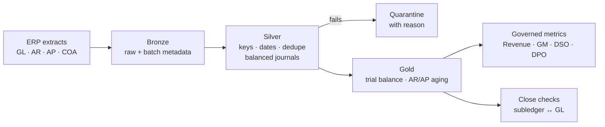

# Finance Lakehouse Reporting Reference

[](https://github.com/dawncreter/finance-lakehouse-reporting-reference/actions/workflows/ci.yml)

This project takes ERP extracts (general ledger, accounts receivable, accounts payable) through a **Bronze → Silver → Gold** lakehouse pipeline. The Gold layer produces a **trial balance**, **AR/AP aging** and a **governed finance scorecard** (Revenue, Gross Margin, DSO, DPO, Data Quality). Each number has one registered definition and owner, plus lineage back to the source rows. A **month-end close check** then reconciles the subledgers to the GL and blocks the close when something doesn't tie.

> **Reference implementation** on synthetic data. It shows the approach behind work I led inside two private-equity-owned companies: the corporate Data Lake I built at Syniverse to automate executive and Board reporting, and the Data Engineering team I directed at Cofense. It is not employer code or data.

## Why it matters
CFOs don't need another dashboard. They need one trusted number per metric that ties to the ledger. Most reporting problems start upstream: duplicate invoices, missing keys, bad dates and journals that don't balance. This pipeline catches those in the Silver layer, holds them in quarantine with a reason, and lets them stop the close instead of quietly flowing into the board pack.

## How it works


| Flow | Where it shows up |
|---|---|
| **Record to Report** | Journal balance control, trial balance, close readiness |
| **Lead to Cash** | AR invoices → AR aging, DSO, AR subledger = GL 1200 |
| **Procure to Pay** | AP bills → AP aging, DPO, AP subledger = GL 2000 |

The synthetic generator plants four defects that real ERP feeds produce: a duplicate invoice, an invoice with no ID, a bill with an impossible date, and an unbalanced manual journal. Each is caught and quarantined.

## Demo
```text
$ finlake scorecard
Finance scorecard 2026-10 (governed metrics, Gold layer)
  Revenue                        $456,797   owner: Controller
  Gross margin                      69.9%   owner: FP&A
  DSO                           16.8 days   owner: Credit & Collections
  DPO                           36.1 days   owner: Accounts Payable
  Data quality pass rate            99.1%   owner: Data Governance

$ finlake close
  [OK] Trial balance nets to zero: expected 0.00, actual 0.00
  [OK] AR subledger = GL 1200 (Lead to Cash): expected 456,797.47, actual 456,797.47
  [OK] AP subledger = GL 2000 (Procure to Pay): expected 172,774.29, actual 172,774.29
  [FAIL] Unbalanced journals held out of GL: expected 0.00, actual 1.00
Close status: BLOCKED: Unbalanced journals held out of GL

$ finlake lineage      # every Gold table traced back to its ERP source
$ finlake quality      # rule-by-rule pass rates and the quarantine
```

## Design choices
- **Governed metrics live in one registry** (`metrics.py`): name, definition, owner and unit. In production this maps to a semantic layer such as dbt metrics or Power BI / Databricks metric views, so finance, BI and AI tools read the same definition.
- **Quarantine, don't drop.** Bad rows keep their reason, so data owners fix the source rather than the report.
- **Lineage is recorded at every hop** with row counts, so an auditor can see where a number came from.
- **Plain Python, no dependencies.** The pattern maps directly to Databricks or Fabric notebooks (Delta tables per layer) or Snowflake tasks.

## Quick start
```bash
pip install -e ".[dev]"
finlake scorecard
finlake close --period 2026-10
make test        # 18 tests, 100% branch coverage
```

## License
MIT
